<p align="center">
  
</p>

<p align="center">
  <a href="https://antblu.net"></a>
  <a href="https://github.com/antblu/antalos"></a>
  <a href="mailto:antblu@antblu.net"></a>
</p>

# Hey, I'm Anthony.

I'm a **System Administrator and System Engineer** working across Windows, Linux, virtualization, networking, and automation. I support infrastructure in an MSP environment and build a self-hosted lab where I can put ideas into practice.

I like understanding the whole path: the network a request crosses, the machine that runs it, the configuration that deploys it, and the signals that explain what went wrong.

```text
antblu@homelab:~$ cat focus.txt

  BUILD       Infrastructure I can recreate from code
  AUTOMATE    Repeatable deployments and everyday administration
  OBSERVE     Metrics that help explain system behavior
  DOCUMENT    Decisions, troubleshooting, and recovery
```

## What I'm building

| Project | Inside the repository |
| :--- | :--- |
| **[Antalos](https://github.com/antblu/antalos)** · Infrastructure & self-hosting | A reusable application-stack and VM template: Talos Kubernetes on Proxmox, OpenTofu provisioning, Argo CD reconciliation, Ansible-managed workloads, and an operations handbook. |
| **[Emiliany](https://github.com/antblu/emiliany)** · Commerce & integration | A bilingual Next.js storefront with Medusa commerce integration. My work spans the interface, service integration, and Kubernetes deployment configuration. |
| **[Portfolio](https://antblu.net)** · Engineering stories | A closer look at my projects, an interactive stack explorer, architecture walkthroughs, resume, and career goals. **[Source](portfolio/dist/)** |

## Tools I work with

<p>
  
  
  
  
  
  
  
  
  
  
  
  
</p>

| Area | My focus |
| :--- | :--- |
| **Systems** | Windows Server, Active Directory labs, Linux/Debian, Proxmox VE, TrueNAS, NFS |
| **Networking** | OPNsense, Juniper switching, VLANs, DNS, DHCP, VPNs, TLS |
| **Delivery** | OpenTofu/Terraform, Ansible, Bash, GitHub Actions, GitOps with Argo CD |
| **Observability** | Grafana, VictoriaMetrics, availability and performance troubleshooting |

<details>
<summary><strong>Open the lab notebook ↗</strong></summary>

### A place to build, break, and understand

My homelab includes **three Proxmox VE nodes** and a **five-node Talos Kubernetes cluster**. I use it to practice infrastructure provisioning, segmented networking, application delivery, monitoring, and recovery.

The workflow I keep coming back to:

```text
  Describe it       Provision it       Reconcile it       Understand it
     Git      ───▶    OpenTofu    ───▶    Argo CD    ───▶  Grafana + docs
                       Ansible           Kubernetes
```

The lab is an evolving learning environment. Project repositories describe configuration and design; they aren't live uptime dashboards.

### Learning in public

I'm pursuing a **Bachelor of Applied Science in Information Technology — System Administration at Ensign College**, expected in 2027. I hold Ensign College's **Technical Support Engineer Certificate**.

I share the implementation and the reasoning behind it through my [portfolio](https://antblu.net) and [Antalos source](https://github.com/antblu/antalos).

</details>

---

<p align="center">
  <strong>Build it. Understand it. Make it repeatable.</strong><br />
  <a href="https://antblu.net">Explore my work</a> · <a href="mailto:antblu@antblu.net">Get in touch</a>
</p>
